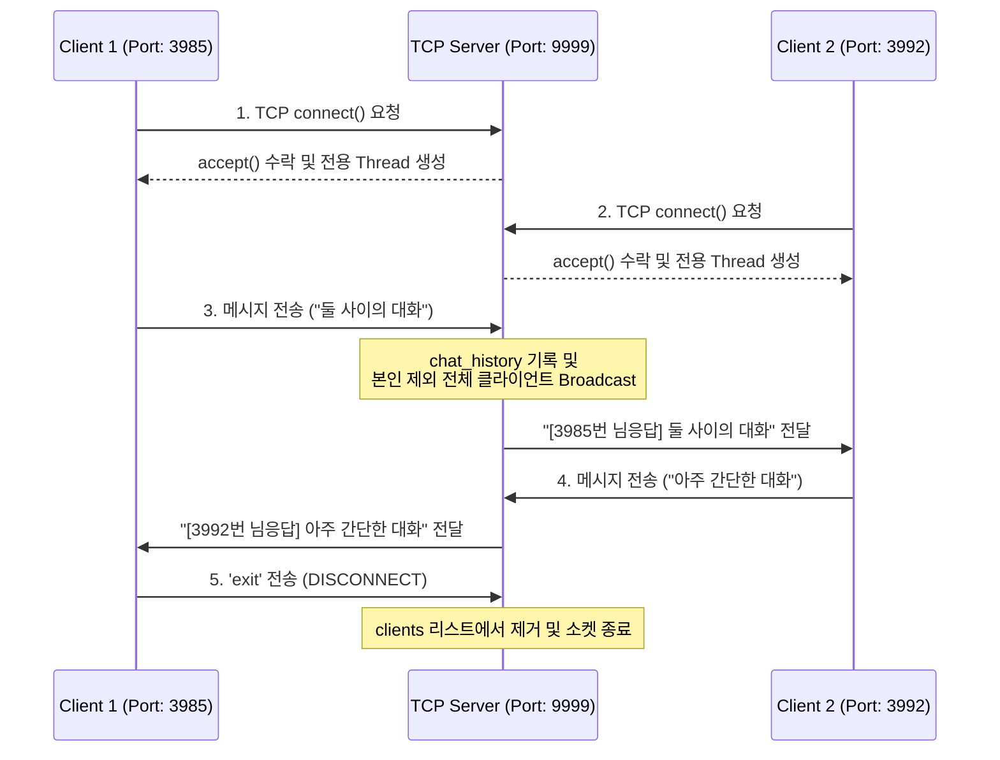
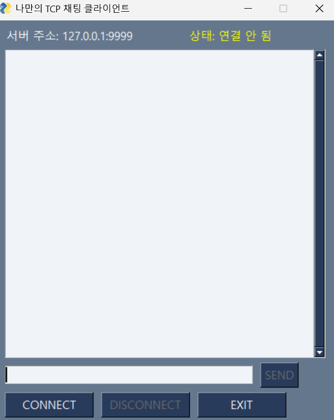
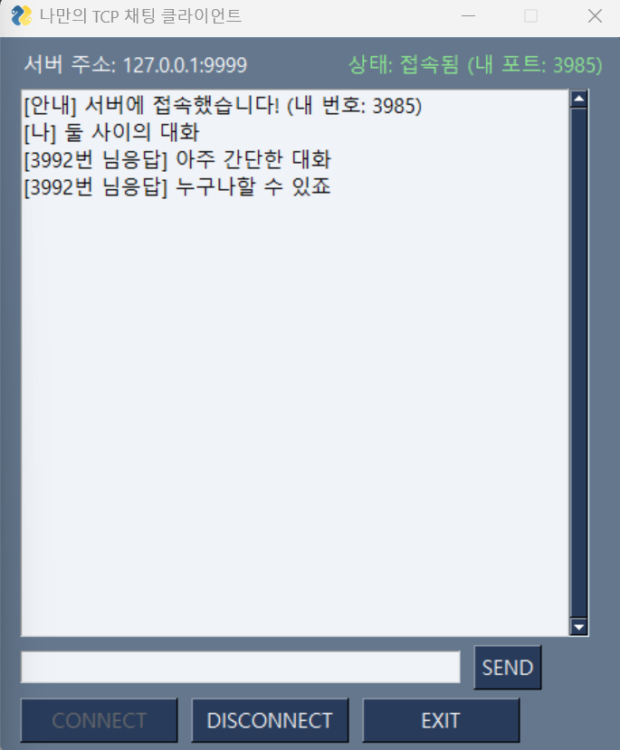
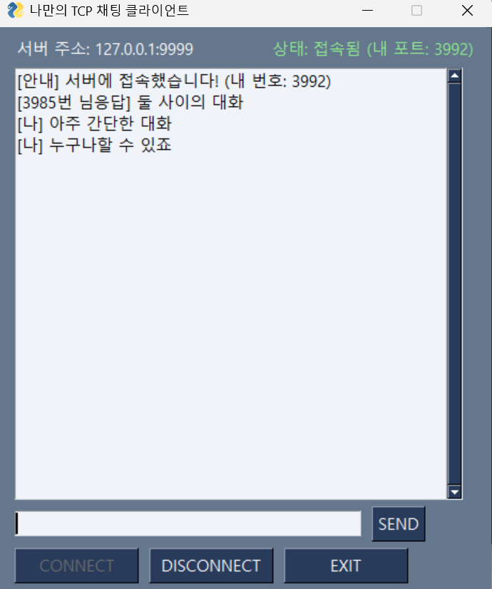
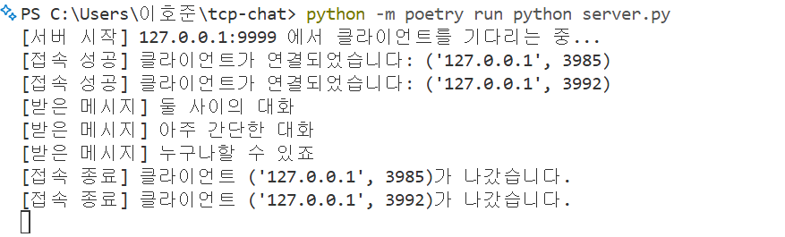

# 💬 Python Multi-Threaded TCP Chat Application

Python의 기본 `socket`과 `threading` 모듈을 활용하여 바닥(Low-level)부터 직접 설계 및 구현한 **다자간 실시간 TCP 데스크톱 채팅 프로그램**입니다.

단일 스레드 에코 서버의 블로킹(Blocking) 한계를 실험을 통해 확인하고, 이를 **멀티스레딩(Multi-threading)** 구조로 확장하여 다중 클라이언트의 동시 접속과 실시간 메시지 브로드캐스팅(Broadcasting)을 구현했습니다.

---

## 🛠️ Tech Stack

| 구분 | 기술 스택 | 설명 |
| :--- | :--- | :--- |
| **Language** | Python 3.14+ | 핵심 서버/클라이언트 로직 구현 |
| **Networking** | `socket` (TCP/IP) | IPv4(`AF_INET`), TCP 스트림(`SOCK_STREAM`) 기반 양방향 통신 |
| **Concurrency** | `threading` | 다중 클라이언트 동시 처리 및 GUI 수신 스레드 분리 |
| **GUI** | `FreeSimpleGUI` (`PySimpleGUI`) | 이벤트 루프 기반 데스크톱 채팅 인터페이스 |
| **Packaging** | `Poetry` | 가상환경 및 의존성 패키지(`pyproject.toml`, `poetry.lock`) 관리 |

---

## 🏛️ 시스템 아키텍처 및 동작 원리



### 핵심 구현 포인트
1. **서버 멀티스레딩 (`server.py`)**
   * 메인 스레드는 `accept()`를 통해 신규 클라이언트의 연결 요청만 전담 대기합니다.
   * 클라이언트가 접속할 때마다 데몬 스레드(`daemon=True`)를 생성하여 `handle_client()`를 실행함으로써, 기존 접속자의 `recv()` 대기가 다른 클라이언트의 접속을 막지 않도록(Non-blocking accept) 설계했습니다.
2. **클라이언트 송·수신 스레드 분리 (`client.py`)**
   * GUI의 메인 이벤트 루프(`window.read()`)가 소켓 수신 대기(`recv()`)로 인해 멈추는(Freezing) 현상을 방지하기 위해, 백그라운드 수신 스레드(`receive_messages`)를 분리하고 `window.write_event_value()`로 스레드 간 안전한 UI 업데이트를 구현했습니다.
3. **패키지 및 라이선스 이슈 해결 (`Poetry` & `FreeSimpleGUI`)**
   * `Poetry`를 도입하여 가상환경과 패키지 버전을 일관되게 관리했습니다.
   * `PySimpleGUI` v5 이후의 유료화 및 라이선스 키 강제 이슈를 해결하기 위해 완벽 호환 오픈소스 포크인 `FreeSimpleGUI`를 적용하여 별도 인증 없이 즉시 실행 가능하도록 개선했습니다.

---

## 🖥️ 실행 화면 (Screenshots)

### 1. 클라이언트 초기 실행 화면 (접속 전)
서버 접속 전에는 메시지 전송(`SEND`)과 연결 해제(`DISCONNECT`) 버튼이 비활성화되어 오작동을 방지합니다.



### 2. 다중 클라이언트 실시간 채팅 화면 (Port 3985 ↔ Port 3992)
각 클라이언트는 고유 로컬 포트 번호로 식별되며, 실시간으로 양방향 대화를 주고받습니다.

| Client 1 (내 포트: `3985`) | Client 2 (내 포트: `3992`) |
| :---: | :---: |
|  |  |

### 3. 서버 터미널 로그 화면
클라이언트의 접속/퇴장 상태와 수신된 메시지를 실시간으로 모니터링하고 관리합니다.



---

## 🚀 설치 및 실행 방법 (Getting Started)

### 1. 저장소 클론 및 패키지 설치
```bash
git clone https://github.com/monolail/tcp-chat-pysimplegui.git
cd tcp-chat-pysimplegui

# Poetry를 이용한 가상환경 생성 및 의존성 설치
python -m poetry install
```

### 2. 채팅 서버 실행
```bash
python -m poetry run python server.py
```

### 3. 채팅 클라이언트 실행 (새 터미널에서 여러 개 실행 가능)
```bash
python -m poetry run python client.py
```
1. 실행된 GUI 창에서 **`CONNECT`** 버튼을 클릭해 서버에 접속합니다.
2. 하단 입력창에 메시지를 입력하고 `Enter` 또는 **`SEND`** 버튼을 눌러 대화합니다.
3. 대화를 마친 후 **`DISCONNECT`** 버튼으로 연결을 안전하게 해제하고 **`EXIT`**로 프로그램을 종료합니다.

---

## 📂 폴더 구조 (Project Structure)

```text
tcp-chat-pysimplegui/
├── server.py          # 멀티스레드 기반 TCP 브로드캐스트 채팅 서버
├── client.py          # FreeSimpleGUI 기반 데스크톱 채팅 클라이언트
├── protocol.py        # Length-prefixed JSON 패킷 송수신 유틸리티 모듈
├── pyproject.toml     # Poetry 프로젝트 설정 및 의존성 명세
├── poetry.lock        # 패키지 버전 잠금 파일
├── screen/            # 실행 화면 스크린샷 이미지
└── README.md          # 프로젝트 문서
```
